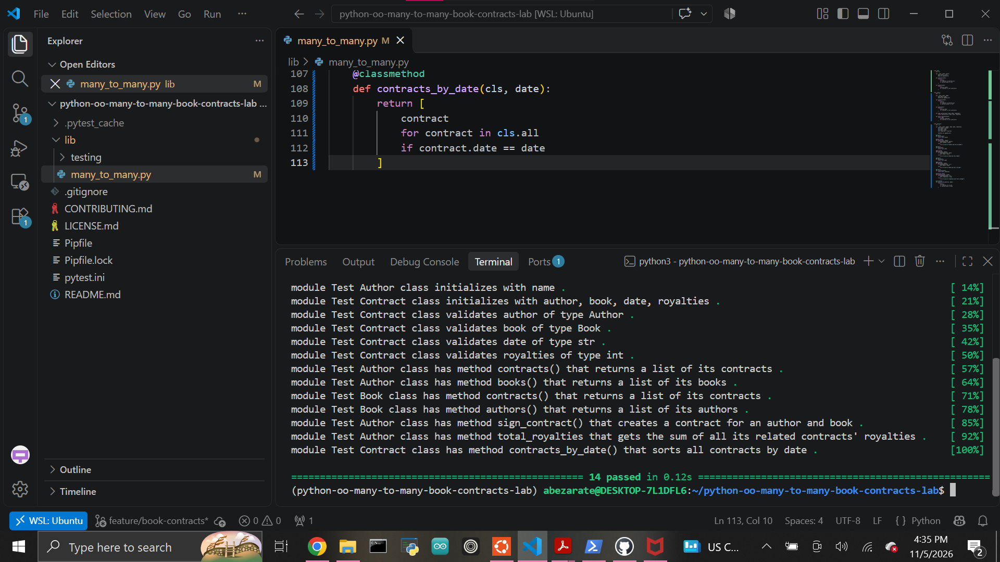

# Many-to-Many Object Relationships Lab

A Python object-oriented programming project that models a many-to-many relationship between authors and books using contracts as an intermediary.

An author can have many books, and a book can have many authors. The `Contract` class connects the two models.

## Relationship Model

```text
Author ↔ Contract ↔ Book
```

The `Contract` class acts as the join model.

Each contract stores:

- An author
- A book
- A contract date
- A royalty amount

## Features

The project supports:

- Creating authors
- Creating books
- Creating contracts
- Tracking all authors
- Tracking all books
- Tracking all contracts
- Finding an author's contracts
- Finding an author's books
- Finding a book's contracts
- Finding a book's authors
- Signing new contracts
- Calculating an author's total royalties
- Finding contracts by date
- Validating contract attributes

## Book Class

Each `Book` object stores a title.

The class also keeps track of all created books using:

```python
Book.all
```

### `contracts()`

Returns all contracts associated with a specific book.

### `authors()`

Returns all authors associated with the book through its contracts.

Example:

```python
book = Book("Example Book")
author = Author("Example Author")

Contract(author, book, "01/01/2001", 50000)

print(book.authors())
```

## Author Class

Each `Author` object stores a name.

The class also keeps track of all created authors using:

```python
Author.all
```

### `contracts()`

Returns all contracts belonging to the author.

### `books()`

Returns all books connected to the author through contracts.

### `sign_contract(book, date, royalties)`

Creates and returns a new `Contract`.

Example:

```python
author = Author("Example Author")
book = Book("Example Book")

contract = author.sign_contract(
    book,
    "01/01/2001",
    60000
)
```

### `total_royalties()`

Returns the sum of all royalties from the author's contracts.

Example:

```python
author.total_royalties()
```

## Contract Class

A `Contract` connects an `Author` and a `Book`.

Each contract stores:

- `author`
- `book`
- `date`
- `royalties`

All contracts are stored in:

```python
Contract.all
```

## Validation

Contract properties are validated before being stored.

### Author

Must be an instance of the `Author` class.

### Book

Must be an instance of the `Book` class.

### Date

Must be a string.

### Royalties

Must be an integer.

Invalid values raise an exception.

## `contracts_by_date()`

Returns all contracts matching a specified date.

Example:

```python
Contract.contracts_by_date("01/01/2001")
```

## Many-to-Many Relationships

The relationship works through the `Contract` class.

For example, `Author.books()` does not store books directly.

Instead, it:

```text
Finds the author's contracts
        ↓
Gets the book from each contract
        ↓
Returns those books
```

The same relationship works in reverse for `Book.authors()`.

## Technologies

- Python 3.8.13
- Pytest
- Pipenv
- Git
- GitHub

## Setup

Clone the repository:

```bash
git clone git@github.com:Abraham-z14/python-oo-many-to-many-book-contracts-lab.git
cd python-oo-many-to-many-book-contracts-lab
```

Install the environment:

```bash
pipenv --python ~/.pyenv/versions/3.8.13/bin/python install
```

Enter the virtual environment:

```bash
pipenv shell
```

## Testing

Run the automated test suite:

```bash
pytest
```

Current result:

```text
14 passed
```

## Completed Test Suite



## Project Structure

```text
python-oo-many-to-many-book-contracts-lab/
├── images/
│   └── tests-passing.png
├── lib/
│   ├── many_to_many.py
│   └── testing/
├── Pipfile
├── Pipfile.lock
├── pytest.ini
└── README.md
```

## Author

Abraham Zarate